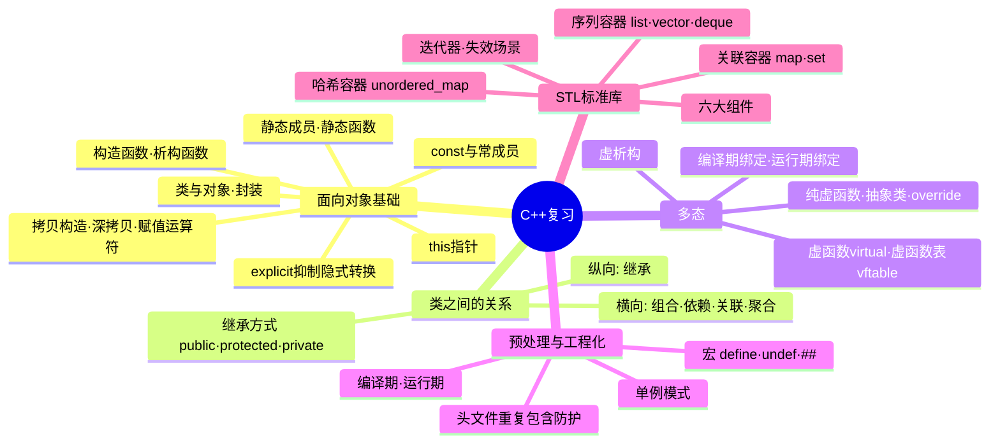

# C++ 复习笔记 · 思维导图总结

> **识别说明**
> - 来源：7 份手写笔记 PDF（`20261109` ~ `20261117(1)`），共 35 页；其中 3 页为空白页（`20261112` 第 9、11 页，`20261113` 第 3 页），已跳过。
> - 整理原则：如实转录手写原文并提炼层级；**无法辨认或与上下文矛盾处用「⚠️存疑」明确标注，不臆测、不编造**。
> - 页码标记形如 `【09-P1】`，表示 `20261109.pdf` 第 1 页，便于回查原笔记。
> - 逻辑主线：面向对象四大特性（封装 / 继承 / 多态 / 抽象）→ 工程化（预处理 / 头文件 / 编译）→ STL 标准库容器与迭代器。

---

## 一、总览思维导图（Mermaid）

---

## 二、详细层级大纲

### 模块 1　类与对象基础、封装、this 与 const（09-P1~P4）

- **1.1 类数据抽象和封装**【09-P1】
  - **类**：完成某一功能数据和算法的集合（C 中只有数据）。
  - **对象**：类的一个实例。
  - **封装的优点**：
    1. 确保不会无意间破坏封装数据的状态；
    2. 类的具体实现可以随时改变。
  - **访问限定**：`class` 默认**私有**（私有继承）；`struct` 默认**公有**（公有继承）。

- **1.2 构造函数 / 析构函数**【09-P1】
  - **构造函数**：用来完成成员初始化；定义类对象时由编译器**自动调用**。
  - 存在默认的无参 / 空构造函数；**一旦手动定义构造，默认构造不再提供**。
  - **析构函数**：对象回收时自动调用；构造、析构**不能是常函数**。

- **1.3 类成员**【09-P2】
  - 空类 `sizeof(A) == 1`：表示占位，用来标识对象真实存在。
  - **成员属性**：归属于对象（定义对象时存在于对象中）；成员函数中使用成员，都是通过 `this` 指针**隐式**使用（形如 `CTest* const this`）。
  - **成员函数**：不占用对象内存空间，由编译器管理，一个类**只存在一份**，所有对象共用；可取地址 `&A::fun`。
  - **this 指针**：存于非静态成员函数（构造、析构）。
  - **初始化参数列表**：用于成员初始化，常量 / 变量都可以；当初始化参数列表生效时，默认初始化失效；**初始化顺序为成员在类中的声明顺序**。

- **1.4 常成员函数与 const**【09-P3】
  - 常成员函数中变量不可修改；`this` 指针类型是**双重 const 修饰**。
  - 两种“突破”方式：
    1. 通过其他指针修改：`int* p = (int*)&this->m_a; *p = 20;`
    2. `mutable` 修饰成员属性，使其在常成员函数中可变。
  - `const` 修饰对象后，意味着不能修改对象本身；执行初始化列表后 `const` 才生效。
  - ⚠️**存疑**：原笔记写「指针（常量）不可指向常量」「指针降级操作 ×，升级 √」——「降级/升级」具体指向不明，字迹潦草，原文照录。
  - ⚠️**存疑**：页末写「const 失效？」，为作者自留的待思考问题，未给出结论。
  - 补充：获取方向键 `_getch();`，需 `#include <conio.h>`。

- **1.5 静态成员 / 静态成员函数**【09-P4、10-P1】
  - **静态成员**：不属于某个对象，归属于**类**；编译期即存在，类中只存一份，与对象无关，多个对象共享同一份。
    - 初始化格式：`类型 类名::成员名 = 值;`【09-P4】
    - 典型场景：统计当前类**实例化对象的数量**（临时对象只计当前作用域）【10-P1】。
  - **静态成员函数**：
    - 没有 `this` 指针【10-P1】；
    - 可以用**类名作用域**直接调用，也可以通过对象调用；
    - 只能访问静态成员。
  - ⚠️**存疑（前后矛盾）**：`10-P1` 正文写「静态函数不能使用静态成员」，但同页“总结”又写「静态函数可以用 this」——两句均与 C++ 常规语义及本页前文矛盾。按原文照录，实际应以「静态函数**只能**使用静态成员、**没有** this 指针」为准，请回看原笔记确认。
  - 调用关系图【10-P1】（原文以箭头标注）：静态函数、常函数、普通函数三者间有的可调用、有的不可（原文用 × 标记禁止）。
  - `error C2266`：不能重载同参数类型的静态与非静态函数【10-P2】。
  - 同名调用规则【10-P2】：常函数与一般函数同名时，按类的类型优先调用；同级函数没有则“升一级”。同名同参数的一般函数与常函数**互为重载**。

### 模块 2　拷贝控制与类型转换（10-P2~P4）

- **2.1 拷贝构造函数**【10-P2】
  - 参数：`const 当前类对象的引用`。
  - 调用时机：用同类型的一个对象去初始化另一个对象。
  - 行为：形参对象中的成员依次给 `this` 对象做初始化。
- **2.2 浅拷贝问题与深拷贝**【10-P2~P3】
  - 默认拷贝构造函数是**浅拷贝**：对指针成员，只拷贝指针值，不拷贝指针指向的空间。
  - 解决方案：**深拷贝**——对指针成员也申请一块属于自己的空间。
  - 函数传参建议：尽量用**引用 / 指针**，避免值传递（及返回值拷贝）。
- **2.3 赋值运算符 `operator=`**【10-P3】
  - 作用：进行功能的拓展。
  - 指针处理分三种情形：`t、this 都有空间` / `t 有、this 无` / `t 无、this 有` / `t、this 都无`——需分别释放与申请，实现深拷贝。
- **2.4 默认函数总结**【10-P3】
  1. 重写拷贝构造函数后，默认无参构造不再提供；
  2. 默认拷贝构造函数是系统提供的（故需手动重写以实现深拷贝）。
- **2.5 显式构造 `explicit`**【10-P4】
  - 构造类型可发生**隐式转换**（把其他类型转换为当前类对象）。
  - 用 `explicit` 禁止隐式转换，将问题暴露出来。

### 模块 3　类之间的关系与继承（11-P1~P3）

- **3.1 类之间的横向关系**【11-P1】
  - **组合（contains a）**：部分与整体，一个类中包含另一个类。【示意 Point ◀▶ main】
  - **依赖（use a）**：一个类中用到另一个类。【示意 a ⟟ b，b 依赖 a】
  - **关联（has a）**：完成某功能时与某对象有关联。【示意 P → friend】
  - **聚合（owns a）**：为了统一管理。【示意 P ◇ Family】
- **3.2 类之间的纵向关系——继承**【11-P1~P2】
  - **父类（基类）/ 子类（派生类）**：子类可以使用父类的成员，子类是对父类的衍生和延续。
  - 语法： subclass **:** 继承方式 父类。
  - 要点：
    1. 计算子类内存大小**也要算上父类**的内存空间；
    2. 子类与父类可定义**同名成员**，默认优先用子类的；也可显式限定以区分不同类的同名成员；
    3. 初始化列表**不能**直接初始化父类成员，需间接初始化；父类中有带参构造时须手动显式调用；子类构造结束后，编译器自动调用父类析构。
- **3.3 继承方式（父类成员在子类中表现的属性）**【11-P2】
  - `public`（公共的）：类内、子类、类外均可用。
  - `protected`（保护的）：只能在类中或子类中使用，无法在类外使用。
  - `private`（私有的）：只能在当前类中使用，子类中不能直接使用（⚠️原文旁注「例外」，具体所指不清）。
- **3.4 总结**【11-P3】：继承的意义——把相似类中可抽离的共性代码抽取出来，便于拓展和复用。

### 模块 4　多态、虚函数与继承和工程化（12-P1~P10）

- **4.1 隐藏与指针转换**【12-P1】
  - 父类与子类**同名函数不构成函数重载**，属于**隐藏**关系：子类会自动隐藏父类同名成员。
  - 父类指针可以不经强转，直接指向子类对象。
- **4.2 指向成员的指针**【12-P1~P2】
  - 成员函数的使用：① 直接按名字调用；② 通过成员函数指针解耦调用。
  - `->*`、`.*`、`::*` 是 C++ 中三个“整体操作符”。
  - 起别名（成员函数指针类型）：
    - `typedef void (Son::*PFUN)(int);`
    - `using P_FUN = void (Son::*)(int);`
  - 与全局函数的区别：① 成员函数自带隐藏的 `this` 指针参数，全局函数没有；② 成员函数受类作用域限制，全局函数属全局作用域。
  - 类指针**向下强转不具备适用性**。
  - 静态成员函数：和全局函数一样，可通过一般指针调用，但有作用域限制。
  - 常函数：常函数指针 + 无名作用域（⚠️此处字迹潦草，原文照录）。
  - 成员属性指针：并非变量的地址，而是**偏移量**。
- **4.3 多态**【12-P3】
  - **编译期绑定（静态绑定）**：通过函数名确定函数。
  - **运行期绑定（动态绑定）**：编译期匹配基类函数，运行期根据子类函数完成绑定。
  - **编译期多态**：函数重载；**运行时多态**：由虚函数实现的动态多态。
  - 显式指定父类类名，就不会延迟绑定（**破除动态绑定**）。
- **4.4 虚函数 `virtual` 与虚函数表**【12-P3~P5】
  - 类中存在虚函数时，编译器默认添加隐藏属性 `vptr`（虚函数表指针），每个对象含此指针，多个对象指向同一个虚函数表。
  - 内存布局：`vptr` 由编译器添加在**首地址位置**（在成员属性之前）。
  - **vftable 虚函数表**（动态数组）：
    - 元素为虚函数指针，数组类型 `void*`；
    - 元素顺序取决于虚函数在类中声明的先后顺序。
  - **调用流程**：先找到对象内存空间中指针大小的空间 → 取出其中存储的地址 → 通过该地址间接调用 → 找到虚表 → 通过下标直接定位到虚表具体元素。
  - 与普通函数的区别：① 调用流程不同；② 效率较低；③ 使用场景不同——实现动态多态，普通函数无法实现多态。
  - **多态实现原理（子类）**【12-P5】：1. 继承；2. 检查虚函数（**原地覆盖 + 保留**）；3. 追加（新增虚函数）。
- **4.5 构造/析构与虚函数**【12-P5~P6】
  - 构造函数**不能**为虚函数；静态成员函数也不能为虚函数；**析构函数可以为虚函数**。
  - 多态下若父类指针指向子类对象，`delete` 时若析构非虚，会导致内存泄漏；**解决：虚析构**（同一般函数一样，也会发生多态）。
  - 析构函数会被编译器重新命名，所以名字看起来一样。
  - ⚠️**存疑**：原文「析构函数可以为虚函数」旁注提到“子类析构…（原地覆盖+保留）”，字迹潦草，仅记大意。
- **4.6 纯虚函数、抽象类、override**【12-P6】
  - **纯虚函数**：在函数参数列表后加 `= 0`，只声明不定义。
  - **抽象类**：含纯虚函数的类；具体类必须重写所有纯虚函数。
  - `override`：表明该函数一定是重写父类的函数。
  - 虚函数静态绑定写法：`父类::eat(){}`，配合“父类对象 + 父类::eat()”。
- **4.7 其他要点**【12-P6~P7】
  - 虚函数缺点：调用虚函数效率低。
  - ⚠️**存疑**：原文「空间：虚函数指针占用空间，随虚表增加（…）」字迹不清，仅记“虚表指针带来额外空间开销”的大意。
  - 类中**私有函数不能为虚函数**，否则报错。
  - 静态变量可以在头文件定义，具有**文件作用域**，只能在当前源文件直接使用。
- **4.8 头文件与源文件**【12-P7~P8】
  - 多个文件编译时，编译器有判重机制；**不要把类的定义放在源文件中**。
  - **头文件**：一般变量、函数的**声明**、类的**定义**（单独头文件存放）。
  - **源文件**：变量、函数的**定义**，类成员的实现（自上而下独立进行编译）。
  - **头文件重复包含防护**【12-P8】：
    - `#pragma once`：头文件仅引入一次；作用——解决头文件在源文件重复包含导致的错误。
    - `#ifndef 宏 / #define 宏 / #endif`：若未定义该宏则执行。
    - 对比：① 常用第一种，效率高、代码少，但缺点是个别编译器不支持；② 预处理方式代码多、逻辑复杂，宏名字可能冲突。
  - 不能在构造函数中创建另一个对象，否则导致头文件相互包含【12-P10】。
- **4.9 编译与运行**【12-P10】
  - **编译**：将源代码文件交给编译器，编译生成可执行程序的过程。
  - **运行期**：将可执行程序交给操作系统执行，直到程序退出的过程。
- **4.10 概念归纳**【12-P10】
  - `class` 类：类成员函数、静态成员属性、构造/析构函数列表、访问修饰符、作用域。
  - 对象：一般成员属性、对象、引用形式、指向对象的指针。

### 模块 5　预处理与设计模式（13-P1~P2）

- **5.1 预处理指令**【13-P1】
  - `#define`：预处理期替换，定义宏。
    - 替换多行代码用 `\`：连接当前行和下一行，最后一行一般不写。
    - 宏参数也是替换作用，**效率低**：不会自动做表达式计算和求解，只是单纯替换。
    - 区分：同名函数与宏，函数名后加 `()` 区分。
  - `#undef`：取消宏定义，作用范围到此为止。
  - 字符串化与连接：
    - `#`：将宏参数变为字符串（加双引号）。
    - `##`：⚠️**存疑**——原文写「变为字符，加单引号」「`#` 用来连接」，两处与标准语义（`#` 字符串化、`##` token 连接）存在出入，字迹潦草，原文照录待核。
- **5.2 设计模式——单例模式**【13-P2】
  1. 当前类最多创建一个实例；
  2. 由类自己创建；
  3. 自己提供拿到全局访问点的方式。
  - 实现要点：**私有**构造函数与拷贝构造（或删除），**静态指针**，**静态**析构，静态回收。

### 模块 6　STL 标准库——容器与迭代器（16、17）

- **6.1 STL 六大组件**【16-P1】：容器、迭代器、算法、容器适配器、空间适配器（分配器）、仿函数。
- **6.2 容器分类**【16-P1】
  - **序列性容器**：保持元素原位置，允许指定插入/删除位置，每个元素都有自己的位置，取决于插入时间。→ `list`、`vector`、`deque`。
  - **关联性容器**：元素位置取决于容器特定的排序规则（与“值”有关）。→ `map`、`set`、`hash_map`（哈希 map）。
  - ⚠️**存疑**：原文「一般和老婆的值有关」应为听写/笔误，推测意为“一般和元素的值有关”，原文照录。

- **6.3 链表 `list`**【16-P1~P4】
  - 声明/初始化：`list<类型> lst(长度, 值);`（指定默认值）；`list<类型> lst{类型...};`
  - 增删：`push_front(类型)` 头增；`pop_back()` 尾删。
  - 中间删除：迭代器移动到指定位置 + `erase()`（迭代器**不支持** `+`、`+=`，**支持** `++`）。
  - 结构：双向循环链表，但支持前驱（`end()` 为有效元素的下一个元素）。
  - 常用成员函数：
    - `insert(it, 类型)`：在 `it` 前插入，返回新插入元素的迭代器。
    - `front()` / `back()`：返回首 / 尾元素的值（等价 `*lst.begin()` / `*--lst.end()`）。
    - `remove(值)`：删除链表中所有等于该值的节点。
    - `unique()`：连续且相同的元素只保留一个。
    - `sort()`：排序，默认升序；`sort(greater<类型>())`：降序。
    - `reverse()`：翻转整个链表。
    - `advance(it, 3)`：`it` 正向偏移 3 个（相当于 `++++`）。
    - `splice(...)`：剪切插入——`splice(it, lst2)`（将 lst2 插到 it 前，lst2 被清空、`size=0`）；`splice(it, lst2, it2)`（将 it2 剪到 it 前）；`splice(it, lst2, itbegin, itend)`（左闭右开区间）。
    - `merge(list& right, Traits Comp)`：合并有序链表，并清空 `right`。
    - `swap(list& right)`：交换两个链表。
  - 复杂度：list 在任意位置插入/删除为 `O(1)`。
  - 【16-P4】练习（原文为印刷题目）：创建 `std::list` 存储自定义 `Person` 结构体（姓名 string、年龄 int 20~40、工资 int 10000~90000），添加 10 个对象（信息随机生成）；工资低于 5000 的按工资升序排序放链表前面，大于等于 5000 的按年龄降序排放后面；年龄大于 30 且工资低于 4000 的信息移除；最后输出剩余人员信息。（⚠️题干中工资范围与阈值 5000/4000 存在不一致，疑似原题笔误，原文照录。）

- **6.4 动态数组 `vector`**【16-P4~P6】
  - 内部成员：`m_ptr` 指向数据、`m_len` 长度（使用量）、`m_capacity` 容量。
  - 尾部操作：尾删（效率高）`= len--`；尾添加（需扩容）按 **1.5 倍**扩容（与 +1 比较），再申请、拷贝。
  - 遍历：`len <= 0` 输出空；`len > 0` 遍历输出。
  - **vector 不会自动缩容**。
  - 迭代器：随机访问型迭代器，支持 `+`、`+=`。
    - `insert(it, x)`：插入元素，返回新插入元素的迭代器。
    - `erase(it)`：删除；原迭代器失效，返回的迭代器指向被删元素的下一个（若不是 `end` 则有效）。
  - **迭代器失效场景**：① 元素位置移动（未扩容时）；② 扩容后全部失效。
  - 容量管理：
    - `clear()`：清空元素，使用量减少，**容量不变**。
    - `empty()`：是否为空，返回 `bool`。
    - `resize(int, int)`：重新指定使用量；若增加且未超过容量则不扩容，超过则扩容。
    - 缩容方法：① `v.shrink_to_fit()`：缩到合适大小（缩减到使用量）；② `vector<int>{}.swap(v)`：交换容量和使用量。
  - **vector 与 list 对比**【16-P6，原文印刷要点】：
    1. vector 连续空间、顺序存储；list 链式结构体、链式存储；
    2. vector 非尾部插入/删除会导致其他元素拷贝移动，list 不影响其他节点；
    3. vector 空间不足需重新分配内存，list 每次插入新节点都申请内存；
    4. vector 随机访问性能好、插入删除差；list 随机访问差、插入删除好；
    5. vector 有容量和使用量概念，list 只有使用量（即长度）概念。

- **6.5 双端队列 `deque`**【16-P7】：动态以**分段连续空间**组合。

- **6.6 关联容器 `map`**【17-P1~P2】
  - `map` 映射表，元素分为**键值 key** 与**实值 value**。
  - 特点：键值唯一、不允许重复，根据键值自动排序。
  - 初始化：`map<类型, 类型> m{{},{},{},...};`
  - 元素访问：`first` 为键值，`second` 为实值；**map 没有 push / pop 方法**。
  - `insert(pair<,>(,))`：
    - 键值已存在 → 插入失败，返回已存在元素的迭代器；
    - 插入成功 → 返回新插入元素的迭代器。
  - 删除 `erase`：
    - ① 按位置删除，返回被删元素的下一个（不支持反向迭代器；传入的迭代器会失效）；
    - ② 按键值删除：`it = m.find('1')` 按 key 查找元素，查找效率 `O(log₂n)`（底层红黑树）。
  - 规则：**不允许修改键值，可以修改实值**。
  - 统计/范围：`count()` 按 key 统计元素数量；`upper_bound()` 返回大于给定 key 的最近元素；`lower_bound()` 返回大于等于给定 key 的元素。
  - 底层：**红黑树**【17-P2 配图】。

- **6.7 关联容器 `set`**【17-P3】
  - 红黑树结构，**不区分键值和实值**；元素值唯一、不允许重复，按元素值自动排序。
  - 操作：`insert()` 插入、`find()` 查找、`erase()` 删除。

- **6.8 哈希容器 `unordered_map`**【17-P3】
  - 基于哈希表，数据存储和查找效率非常高，几乎可当常量级，但消耗更多内存。
  - 解决哈希冲突：**拉链法**、**线性探测法**。

- **6.9 类型推导 `auto`**【17-P3】：基于初始值自动推导出相应类型。

---

## 三、待确认清单（无法辨认 / 存疑汇总）

| 序号 | 位置 | 原文 | 问题 |
|---|---|---|---|
| 1 | 09-P3 | 「指针降级操作 ×，升级 √」 | 降级/升级指向不明，字迹潦草 |
| 2 | 09-P3 | 「const 失效？」 | 作者自留问题，无结论 |
| 3 | 10-P1 | 「静态函数不能使用静态成员」与「静态函数可以用 this」 | 与同页及 C++ 语义矛盾，疑为笔误 |
| 4 | 11-P2 | private「例外」旁注 | 具体所指不清 |
| 5 | 12-P6 | 「随虚表增加（…）」 | 字迹不清，仅记大意 |
| 6 | 13-P1 | `#` / `##` 的描述 | 与标准语义有出入，待核 |
| 7 | 16-P1 | 「一般和老婆的值有关」 | 疑为笔误，推测为“和元素的值有关” |
| 8 | 16-P4 | 练习题工资阈值 5000/4000 与给定范围 | 题面数值不一致，疑原题笔误 |

---

*本文档由手写笔记识别整理而成，仅供复习参考；如有疑问请以原始手写笔记及教材为准。*
