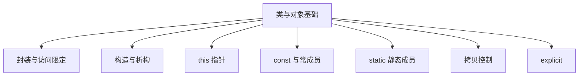
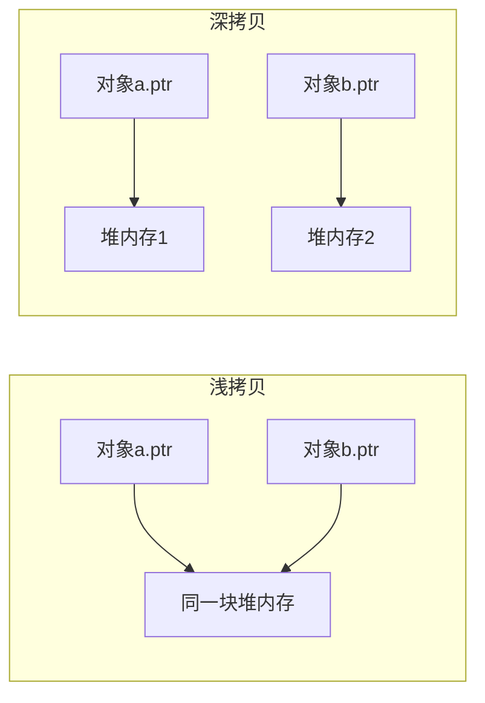

# 01 · 类与对象基础

> [← 返回索引](./README.md) · 来源：`20261109`（4 页）、`20261110`（4 页）
> 核心问题：**怎样把一个类写对、写安全？** 关键词：封装、构造/析构、this、const、static、拷贝控制。

---

## 🧭 本文件结构



---

## 1. 类、对象与封装

### 1.1 基本概念
- **类（class）**：完成某一功能**数据和算法的集合**（C 语言中只有数据，没有把算法绑在一起）。
- **对象（object）**：类的一个**实例**。
- **封装的两个优点**：
  1. 确保不会无意间破坏被封装数据的状态；
  2. 类的具体实现可以随时改变（对外接口不变）。

### 1.2 访问限定符对比

| 限定符 | 类内 | 子类 | 类外 | 默认继承方式 |
|---|---|---|---|---|
| `public` | ✅ | ✅ | ✅ | — |
| `protected` | ✅ | ✅ | ❌ | — |
| `private` | ✅ | ❌ | ❌ | — |

> **class 与 struct 的区别**：`class` 默认 **private**（默认私有继承）；`struct` 默认 **public**（默认公有继承）。

**代码示例（补充，非原笔记原文）**：
```cpp
class A { int x; };      // x 默认 private，类外不可访问
struct B { int x; };     // x 默认 public，类外可访问

// 空类大小为 1：编译器插入一个占位字节，标识对象真实存在
cout << sizeof(A) << endl;   // 输出 1
```

---

## 2. 构造函数与析构函数

- **构造函数**：完成成员初始化；**定义对象时由编译器自动调用**。
- 存在默认的无参 / 空构造函数；**一旦手动定义了构造函数，默认的无参构造不再提供**。
- **析构函数**：对象回收时**自动调用**。
- **构造、析构都不能是常函数**（不能加 `const`）。

**代码示例（补充）**：
```cpp
class Test {
public:
    Test()  { cout << "构造" << endl; }   // 手动定义后，默认无参构造消失
    ~Test() { cout << "析构" << endl; }
};
```

---

## 3. 类成员的存储规则

### 3.1 成员属性 vs 成员函数

| 项目 | 归属 | 存储位置 | 数量 |
|---|---|---|---|
| 成员属性 | 对象 | 对象空间中（栈上等） | 每个对象各一份 |
| 成员函数 | 类 | 编译器统一管理 | **全类只一份**，所有对象共用 |

- 成员函数中使用成员属性，都是通过 **`this` 指针隐式访问**（形式如 `CTest* const this`）。
- 空类 `sizeof(A) == 1`：**占位**，用来标识对象真实存在。
- 成员函数可取地址：`&A::fun`。

**图示（对象内存布局）**：
```
对象 a1 ──┐
对象 a2 ──┼──▶ 共享同一份成员函数代码（代码区，全类唯一）
对象 a3 ──┘
每个对象内部：自己的成员属性 + this 指针隐式传入
```

### 3.2 初始化参数列表
- 用于成员初始化，**常量、变量都可以**。
- 初始化列表**生效时，默认初始化失效**。
- **初始化顺序 = 成员在类中的声明顺序**（与实际书写顺序无关）。

**代码示例（补充）**：
```cpp
class A {
    int b;  // 先声明
    int a;  // 后声明
public:
    // 实际先初始化 b，再初始化 a —— 与列表中书写顺序无关
    A(int x) : a(x), b(x + 1) {}
};
```

---

## 4. this 指针

- `this` 是**隐式指针**，存于**非静态成员函数**中（构造、析构也有）。
- 类型：`CTest* const this`（指针本身不可改指向）。
- 常函数中的 `this`：**双重 const 修饰**（详见下节）。

---

## 5. const 与常成员函数

### 5.1 常成员函数规则
- 常成员函数中，**成员属性不可被修改**。
- `this` 指针类型是**双重 const 修饰**。
- **构造、析构不能是常函数**。
- `const` 修饰对象后，意味着**不能改对象本身**；**执行初始化列表后 const 才生效**。

### 5.2 常函数中"修改"成员的两种途径
1. **通过其他指针强制修改**（绕过编译期检查，不推荐）：
   ```cpp
   int* p = (int*)&this->m_a;
   *p = 20;
   ```
2. **`mutable` 修饰成员属性**：使其在常成员函数中可变。
   ```cpp
   class A { mutable int cnt; public: void f() const { cnt++; } }; // OK
   ```

### 5.3 指针的 const 升级 / 降级（已审校修正）

> ⚠️ 原文「指针降级操作 ×，升级 √」经回查确认为真实表述，指 **const 限定**：
> - **升级（增加 const）√ 允许**；
> - **降级（去掉 const）× 不允许**。
> - 配套规则：**常量指针不可指向常量**（原笔记表述，指 const 相关的赋值限制）。

```cpp
int* p = nullptr;
const int* cp = p;   // 升级：加 const，允许 ✓
// int* q = cp;      // 降级：去 const，不允许 ✗
```

> 📌 原笔记页末留有「const 失效？」的自问，**原笔记未给出结论**，此处不臆测答案。

### 5.4 获取方向键
- 使用 `_getch();`，需包含头文件 `#include <conio.h>`。

---

## 6. static 静态成员与静态函数

### 6.1 静态成员属性
- **不属于某个对象**，归属于**类**；编译期即存在。
- 类中**只有一份**，与对象无关，多个对象**共享同一份**。
- 初始化格式：`类型 类名::成员名 = 值;`

### 6.2 静态成员函数（已审校修正）

> ⚠️ 原文「静态函数可以用 this」与同页第 1 条「没有 this 指针」矛盾，判为笔误，正确表述为**没有 this 指针**。

**静态函数 vs 一般函数**：
1. **没有 this 指针**；
2. **不能引用非静态成员**（只能访问静态成员）；
3. 可以用**类名作用域直接调用**，也可以通过对象调用。

**典型场景**：统计当前类**实例化对象的数量**（临时对象只计当前作用域，如 `CTest();`）。

**调用关系**（原文箭头图，× 表示不可调用）：
```
普通函数 ⟷ 常函数 ⟷ 静态函数
           （部分方向受限，标 ×）
```
- 常函数**必须**通过 this 调用。
- `error C2266`：不能重载**参数类型相同的静态与非静态函数**。

**代码示例（补充）**：
```cpp
class CTest {
    static int count;   // 声明
public:
    CTest()  { ++count; }
    ~CTest() { --count; }
    static int getCount() { return count; }  // 静态函数只访问静态成员
};
int CTest::count = 0;   // 类外初始化

cout << CTest::getCount();  // 类名作用域调用 ✓
```

### 6.3 同名函数的调用优先级
- 常函数与一般函数同名时，根据**对象是否为 const** 优先调用对应版本；
- 同名同参数的一般函数与常函数**互为重载**。

---

## 7. 拷贝控制

### 7.1 拷贝构造函数
- 参数形式：`const 当前类名&`（当前类对象的常量引用）。
- **调用时机**：用同类型的一个对象去初始化另一个对象。
- 行为：形参对象中的成员**依次**给 `this` 对象做初始化。

### 7.2 浅拷贝问题与深拷贝（重点）
- **默认的拷贝构造函数是浅拷贝**：对指针成员只拷贝指针值，**不拷贝指针指向的空间** → 两个对象指向同一块内存，析构时重复释放。
- **解决方案——深拷贝**：对指针成员，也申请一块**属于自己的空间**。



### 7.3 传参建议
- 函数形参**尽量用引用 / 指针**，尽量避免值传递（及返回值拷贝）。

### 7.4 赋值运算符 `operator=`
- 用于**功能拓展**；指针成员需按 4 种空间组合分别处理：

| 情形 | t 的空间 | this 的空间 | 处理 |
|---|---|---|---|
| 1 | 有 | 有 | 先释放 this 原有空间，再深拷贝 |
| 2 | 有 | 无 | 直接申请并深拷贝 |
| 3 | 无 | 有 | 释放 this 空间，置空 |
| 4 | 无 | 无 | 置空 |

### 7.5 默认函数总结
1. 重写拷贝构造函数后，默认无参构造不再提供；
2. 默认拷贝构造函数由系统提供（需手动重写以实现深拷贝）。

**深拷贝代码示例（补充）**：
```cpp
class A {
    int* p;
public:
    A(int v) : p(new int(v)) {}
    // 拷贝构造：深拷贝
    A(const A& other) : p(new int(*other.p)) {}
    // 赋值运算符：深拷贝，注意自赋值与旧空间释放
    A& operator=(const A& other) {
        if (this != &other) {
            delete p;
            p = new int(*other.p);
        }
        return *this;
    }
    ~A() { delete p; }
};
```

---

## 8. explicit 禁止隐式转换

- 构造类型可以发生**隐式转换**：把其他类型转换为当前类对象。
- 用 `explicit` **禁止隐式转换**，把问题暴露出来。

**代码示例（补充）**：
```cpp
class A { public: A(int x) {} };
void f(A a) {}

f(10);   // 隐式转换 int → A，悄悄发生

class B { public: explicit B(int x) {} };
void g(B b) {}
// g(10);  // 编译错误：explicit 禁止隐式转换
// 必须显式：g(B(10));
```

---

## 📌 本文件速查

- 写类先想：访问限定 → 构造/析构 → 是否需要拷贝控制（Rule of Three）。
- 有指针成员 ⇒ **必须**重写拷贝构造 + 赋值运算符（深拷贝）。
- `const` 成员函数 + `mutable` 成员 = 逻辑常量性。
- 想统计对象数 ⇒ `static` 成员。

*返回 [索引](./README.md) · 下一步建议阅读 [02 · 类关系与继承](./02-类关系与继承.md)*
