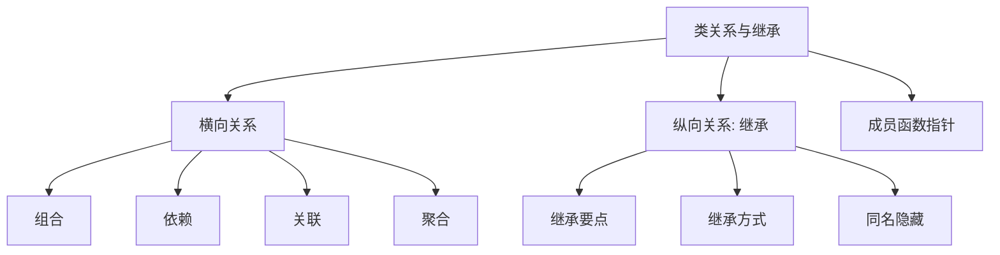

# 02 · 类关系与继承

> [← 返回索引](./README.md) · 来源：`20261111`（3 页）、`20261112-p1`（部分）
> 核心问题：**类与类之间有哪些关系？如何安全地复用代码？**

---

## 🧭 本文件结构



---

## 1. 类之间的横向关系（4 种）

| 关系 | 口语记忆 | 含义 | UML 示意 |
|---|---|---|---|
| **组合** | contains-a | 部分与整体，一个类中包含另一个类（强拥有，同生共死） | `Point ◀◆ main` |
| **依赖** | use-a | 一个类中用到另一个类（临时、偶然） | `a ⟟ b`（b 依赖 a） |
| **关联** | has-a | 完成某功能时与某对象有关联 | `P → friend` |
| **聚合** | owns-a | 为了统一管理而聚在一起（弱拥有，可独立） | `P ◇ Family` |

**耦合强度**（由强到弱）：
```
组合 > 聚合 > 关联 > 依赖
强 ──────────────────▶ 弱
```

**代码示例（补充，展示组合与依赖）**：
```cpp
// 组合：Part 是 Whole 的一部分，生命周期绑定
class Part {};
class Whole {
    Part p;   // 成员对象，Whole 析构时 p 一起销毁
};

// 依赖：函数参数中临时使用
class Tool {};
class Worker {
public:
    void use(Tool& t) {}   // use-a，不持有
};
```

---

## 2. 类之间的纵向关系——继承

### 2.1 基本概念
- **父类（基类）/ 子类（派生类）**：子类可以使用父类的成员，子类是对父类的**衍生和延续**。
- 语法：`class 子类 : 继承方式 父类 { ... };`

### 2.2 继承的 3 个要点
1. 计算子类内存大小时，**也要算上父类**的内存空间（父类子对象在前）。
2. 子类和父类可以定义**同名成员**：默认优先用子类的；也可**显式限定**区分各类的同名成员（`父类::成员`）。
3. 初始化列表**不能直接初始化父类成员**，需间接初始化：
   - 当父类中存在带参数构造函数时，需要**手动显式调用**；
   - 子类构造结束后，编译器**自动调用父类析构**。

**对象内存布局示意**：
```
子类对象
┌──────────────┐
│ 父类子对象部分 │  ← 基类成员在前
├──────────────┤
│ 子类新增成员   │
└──────────────┘
```

**代码示例（补充）**：
```cpp
class Base {
public:
    Base(int x) : b(x) {}
    ~Base() { cout << "~Base" << endl; }
protected:
    int b;
};
class Derived : public Base {
    int d;
public:
    // 父类带参构造 → 必须在初始化列表显式调用
    Derived(int x, int y) : Base(x), d(y) {}
    // 析构顺序：先 ~Derived，编译器自动再调 ~Base
};
```

---

## 3. 继承方式（父类成员在子类中表现的属性）

| 继承方式 | public 成员 | protected 成员 | private 成员 |
|---|---|---|---|
| `public` | public | protected | 不可直接访问（⚠️见下） |
| `protected` | protected | protected | 不可直接访问 |
| `private` | private | private | 不可直接访问 |

- **protected（保护的）**：只能在类中或子类中使用，**无法在类外使用**。
- **private（私有的）**：只能在当前类中使用，**无法在子类中直接使用**。
  - ⚠️ **原笔记在此处标注了「例外」二字**，未展开说明。可补充说明：标准 C++ 中存在例外情形（如**友元 friend**、通过**基类 public/protected 接口间接访问**），但原笔记未写明具体所指，此处不臆断。

---

## 4. 同名函数隐藏（不构成重载）

- **父类与子类的同名函数不构成函数重载**，属于**隐藏**关系：子类会**自动隐藏**父类同名成员。
- 想调用被隐藏的父类版本，必须显式加 `父类::`。

**代码示例（补充）**：
```cpp
class Base   { public: void f(int) {} };
class Derived : public Base { public: void f(double) {} };

Derived d;
d.f(1);             // 调用 Derived::f(double)，Base::f 被隐藏
d.Base::f(1);       // 显式调用父类版本 ✓
```

### 4.1 父类指针指向子类对象
- 父类指针**可以不通过强转，直接指向子类对象**（多态的基础）。
- 但**子类指针向下强转不具备适用性**（需谨慎，通常需 `dynamic_cast`）。

---

## 5. 类成员函数指针（进阶）

### 5.1 两种使用方式
1. 直接按名字调用；
2. 通过**函数指针解耦调用**。

### 5.2 三个"整体操作符"
- `->*`、`.*`、`::*` 是 C++ 中的三个整体操作符。

### 5.3 成员函数指针类型起别名
```cpp
typedef void (Son::*PFUN)(int);        // 传统 typedef
using   P_FUN = void (Son::*)(int);    // C++11 using
```

### 5.4 成员函数指针 vs 全局函数指针
1. 成员函数**自带隐藏的 this 指针参数**，全局函数没有；
2. 成员函数受**类作用域限制**，全局函数属于全局作用域。

### 5.5 静态成员函数与常函数指针
- **静态成员函数**：和全局函数一样，可通过一般指针调用，但有作用域限制。
- **常函数**：常函数指针 + 无名作用域。
- **成员属性指针**：并非变量的地址，而是**偏移量**。

**代码示例（补充）**：
```cpp
class Son {
public:
    void func(int x) { cout << x; }
    static void sfunc(int x) {}
};
using PFUN = void (Son::*)(int);

Son s;
PFUN pf = &Son::func;
(s.*pf)(10);        // .* 配合对象
Son* ps = &s;
(ps->*pf)(20);      // ->* 配合对象指针

void (*gpf)(int) = &Son::sfunc;  // 静态函数退化为普通函数指针
gpf(30);
```

---

## 6. 继承的意义（总结）

> 有一些**相似的类**，里面会有一些**代码可以抽离出来**，放到父类中，便于**拓展和复用**。

---

## 📌 本文件速查

- 描述"整体-部分"用**组合/聚合**；"使用"用**依赖**；"关联"用 has-a。
- 复用代码、形成 is-a 关系 ⇒ **继承**；优先 `public` 继承。
- 同名函数 = **隐藏**，不是重载；想调父类版本要 `Base::f()`。
- 父类指针指向子类对象 = 多态前提，联想 [03 · 多态与虚函数](./03-多态与虚函数.md)。

*返回 [索引](./README.md) · 上一篇 [01 · 类与对象基础](./01-类与对象基础.md)*
