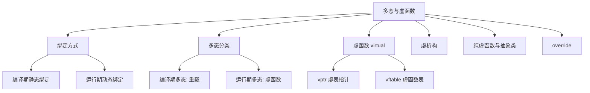

# 03 · 多态与虚函数

> [← 返回索引](./README.md) · 来源：`20261112`（11 页，其中 3、9、11 页空白或极少）
> 核心问题：**同一条调用语句，为什么能表现出不同行为？** 这是 C++ 面向对象最核心、也最容易被追问原理的部分。

---

## 🧭 本文件结构



---

## 1. 绑定方式：静态绑定 vs 动态绑定

| 类型 | 别名 | 时机 | 依据 | 例子 |
|---|---|---|---|---|
| **编译期绑定** | 静态绑定 | 编译期 | 通过**函数名**确定调用哪个函数 | 函数重载、普通函数 |
| **运行期绑定** | 动态绑定 | 运行期 | 编译期匹配基类函数，运行期根据**对象实际类型**找到子类函数完成绑定 | 虚函数 |

- **编译期多态**：函数重载。
- **运行时多态**：由**虚函数**实现的动态多态。
- **破除动态绑定**：显式指定父类类名（如 `对象.父类::func()`），就不会延迟绑定。

---

## 2. 虚函数 `virtual` 与虚表机制

### 2.1 虚函数的隐藏属性
- 当类中存在虚函数，编译器会默认添加隐藏属性：**`vptr`（虚表指针）**。
- 每个（含虚函数的）对象中都有这个指针，**多个同类对象指向同一张虚函数表**。
- **内存布局**：`vptr` 由编译器添加在对象的**首地址位置**（在成员属性之前）。

**对象内存布局示意**：
```
对象内存
┌────────────┐
│  vptr ─────┼──▶ 虚函数表 vftable
├────────────┤      ┌──────────────┐
│ 成员属性     │      │ 虚函数1 地址   │
└────────────┘      │ 虚函数2 地址   │
                    └──────────────┘
```

### 2.2 vftable（虚函数表）
- 本质是**动态数组**，元素为虚函数指针，数组类型 `void*`。
- **元素顺序**：取决于虚函数在类中声明的先后顺序。

### 2.3 虚函数调用流程（重点）
1. 找到对象内存空间中**指针大小**的空间（即 vptr）；
2. 取出里面存储的**虚表地址**；
3. 通过该地址**间接调用**，找到虚表；
4. 通过**下标**直接定位到虚表里的具体函数元素。


### 2.4 子类如何形成自己的虚表
> 原文「子类：1.继承 2.检查虚函数（原地覆盖+保留）3.追加」

1. **继承**父类的虚表结构；
2. **检查**每个虚函数：子类重写了就**原地覆盖**，没重写就**保留**父类版本；
3. **追加**子类新增的虚函数。

### 2.5 虚函数 vs 普通函数

| 对比项 | 虚函数 | 普通函数 |
|---|---|---|
| 调用流程 | 间接（经 vptr→虚表） | 直接调用 |
| 效率 | 较低 | 较高 |
| 使用场景 | 实现**动态多态**，普通函数无法实现多态 | 一般调用 |

### 2.6 虚函数的限制与代价
- **构造函数不能是虚函数**；**静态成员函数也不能是虚函数**；**析构函数可以是虚函数**。
- **类中私有（private）函数不能为虚函数**，否则报错。
- 虚函数缺点（已审校修正）：
  1. **调用效率低**（多一次间接寻址）；
  2. **空间开销**：对象内多一个虚表指针，**每个类多一张虚表**，随虚函数数量增加而变大。

---

## 3. 虚析构（重要，防内存泄漏）

- **问题场景**：多态下，父类指针指向子类对象，`delete` 时若析构函数**非虚**，只会调用父类析构 → **子类资源未释放，内存泄漏**。
- **解决方案**：把析构函数声明为 **`virtual`**——虚析构同一般函数一样，也会发生多态，`delete` 时能正确调用到子类析构。

**代码示例（补充）**：
```cpp
class Base {
public:
    virtual ~Base() { cout << "~Base"; }   // 虚析构
};
class Derived : public Base {
public:
    ~Derived() override { cout << "~Derived"; }
};
Base* p = new Derived();
delete p;   // 输出 ~Derived → ~Base，正确释放 ✓
// 若 ~Base 非虚：只输出 ~Base，Derived 资源泄漏 ✗
```

> 💡 补充：析构函数会被编译器**重新命名**（内部名字特殊处理），所以父子析构"名字看起来一样"但能正确形成多态链。

---

## 4. 纯虚函数与抽象类

### 4.1 纯虚函数
- 形式：在函数参数列表后加 `= 0`，**只声明，不定义**（在基类中）。
  ```cpp
  virtual void eat() = 0;   // 纯虚函数
  ```

### 4.2 抽象类与具体类
- **抽象类**：含纯虚函数的类，**不能实例化**。
- **具体类**：对于抽象的纯虚函数，**必须重写**后才能实例化。

### 4.3 虚函数静态绑定的特例
- 写法 `父类::eat() { ... }` + "父类对象 + 父类::eat()" 可绕过动态绑定，直接调用指定版本。

---

## 5. `override` 关键字

- 作用：**表明这个函数一定是重写父类的函数**（编译器帮你检查）。
- 若签名不匹配（没真正重写），编译器直接报错，避免"以为重写了其实没有"的隐蔽 bug。

```cpp
class Derived : public Base {
public:
    void eat() override { /* 必须确实重写了 Base::eat */ }
};
```

---

## 6. 多态的完整代码示例（补充）

```cpp
#include <iostream>
using namespace std;

class Animal {
public:
    virtual void speak() = 0;          // 纯虚函数 → 抽象类
    virtual ~Animal() = default;       // 虚析构
};
class Dog : public Animal {
public:
    void speak() override { cout << "汪汪" << endl; }
};
class Cat : public Animal {
public:
    void speak() override { cout << "喵喵" << endl; }
};

void makeSpeak(Animal& a) { a.speak(); } // 同一接口

int main() {
    Dog d; Cat c;
    makeSpeak(d);   // 汪汪  —— 运行期根据实际类型绑定
    makeSpeak(c);   // 喵喵
}
```

---

## 📌 本文件速查

- 想让父类指针/引用"调用到子类版本" ⇒ 父类函数加 `virtual`。
- 多态类**务必写虚析构**，否则删除子类对象会泄漏。
- 强制子类实现某接口 ⇒ **纯虚函数 `= 0`**。
- 重写加 `override`，让编译器帮你校验。
- 理解原理记三步：**vptr → 虚表 → 下标定位**。

*返回 [索引](./README.md) · 上一篇 [02 · 类关系与继承](./02-类关系与继承.md) · 下一篇 [04 · 预处理与工程化](./04-预处理与工程化.md)*
