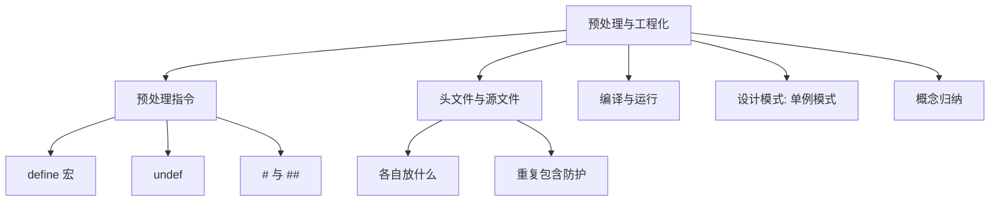

# 04 · 预处理与工程化

> [← 返回索引](./README.md) · 来源：`20261112-p6~p10`、`20261113`（3 页）
> 核心问题：**怎样把代码组织成多文件工程？宏怎么用才不踩坑？**

---

## 🧭 本文件结构



---

## 1. 预处理指令

### 1.1 `#define` —— 预处理期替换，定义宏
- **替换多行代码**用 `\`：连接当前行和下一行，**最后一行一般不写反斜杠**。

**代码示例（补充）**：
```cpp
#define PRINT(x) cout << x << endl; \
                 cout << "---" << endl
```

### 1.2 宏参数
- 宏参数也是**替换作用**，**效率低**。
- **不会自动做表达式的计算和求解，只是单纯替换**。

**经典陷阱（补充）**：
```cpp
#define SQUARE(x) x * x
SQUARE(1 + 2);   // 替换成 1 + 2 * 1 + 2 = 5，不是 9！
// 正确写法：#define SQUARE(x) ((x) * (x))
```

> 区分：同名函数与宏，**函数名后加 `()`** 来区分调用。

### 1.3 `#undef`
- **取消宏定义**，作用范围到此为止。

### 1.4 `#` 与 `##`（已审校修正）

> ⚠️ 原文三行经回查确认为：`#`→字符串化（加双引号）；`##`→用来连接；中间另有一行「变字符、加单引号」。
> **修正结论**：标准 C++ 中——
> - `#`：把宏参数**字符串化**（加**双引号**）✓；
> - `##`：**token 连接**（拼接标识符）✓；
> - 原文「变字符、加单引号」一行**不符合标准 C++**（无此预处理运算符），判为原笔误/误记，不计入正确知识点。

**代码示例（补充）**：
```cpp
#define STR(x) #x              // 字符串化
#define CAT(a, b) a##b         // token 拼接
cout << STR(hello);            // "hello"
int CAT(my, Var) = 42;         // 定义变量 myVar
```

---

## 2. 头文件与源文件

### 2.1 各自放什么

| 文件 | 放置内容 | 说明 |
|---|---|---|
| **头文件 `.h`** | 一般变量、**函数的声明**、**类的定义** | 单独头文件存放；供多个源文件包含 |
| **源文件 `.cpp`** | 变量、函数的**定义**，**类成员的实现** | 自上而下**独立进行编译** |

- **静态变量**可以在头文件定义，具有**文件作用域**，只能在当前源文件直接使用。
- 编译器具有**判重机制**；**不要把类的定义放在源文件中**（应放头文件）。
- 不能在构造函数中创建另一个对象，否则导致**头文件相互包含**。

### 2.2 头文件重复包含防护

**方式一：`#pragma once`**
- 头文件**仅引入一次**；作用：解决头文件在源文件重复包含导致的错误。
- 优点：效率高、代码少；缺点：个别编译器不支持。

**方式二：头文件守卫（`#ifndef` / `#define` / `#endif`）**
```cpp
#ifndef __MYHEADER_H__
#define __MYHEADER_H__
// ... 头文件内容 ...
#endif
```
- 逻辑：如果没有定义这个宏，则执行；定义了则跳过。
- 缺点：代码多、逻辑复杂，**宏名字有可能冲突**。

> 对比：① 常用第一种（`#pragma once`），效率高代码少；② 预处理方式兼容性更好但代码多。

---

## 3. 编译与运行


- **编译**：将源代码文件交给编译器，编译生成可执行程序的过程。
- **运行期**：将可执行程序交给操作系统执行，直到程序退出的过程。

---

## 4. 设计模式：单例模式

> 保证一个类**只有一个实例**，并提供一个全局访问点。

**三个要点**：
1. 当前类**最多创建一个实例**；
2. 由**类自己创建**；
3. 自己提供**拿到全局访问点**的方式。

**实现要点**：
- **私有**构造函数和拷贝构造（或直接 `delete`），禁止外部创建/复制；
- **静态指针**保存唯一实例；
- **静态**获取接口、**静态析构**、静态回收。

**代码示例（补充，懒汉式）**：
```cpp
class Singleton {
    static Singleton* instance;
    Singleton() {}                              // 私有构造
    Singleton(const Singleton&) = delete;       // 删除拷贝
public:
    static Singleton* getInstance() {
        if (!instance) instance = new Singleton();
        return instance;
    }
    static void destroy() { delete instance; instance = nullptr; }
};
Singleton* Singleton::instance = nullptr;
```

---

## 5. 概念归纳（原文总结）

**class 类包含**：
- 类成员函数
- 静态成员属性
- 构造函数列表（构造/析构）
- 访问修饰符
- 作用域

**对象包含**：
- 一般成员属性
- 对象本体
- 引用形式
- 指向对象的指针

---

## 📌 本文件速查

- 多文件工程：类定义放**头文件**，成员实现放**源文件**。
- 每个头文件都要加 `#pragma once` 或守卫。
- 宏只是**文本替换**，表达式要加括号；能用常量/`inline`/`constexpr` 就别用宏。
- 全局唯一对象 ⇒ **单例模式**（私有构造 + 静态指针 + 静态访问点）。

*返回 [索引](./README.md) · 上一篇 [03 · 多态与虚函数](./03-多态与虚函数.md) · 下一篇 [05 · STL 序列式容器](./05-STL序列式容器.md)*
