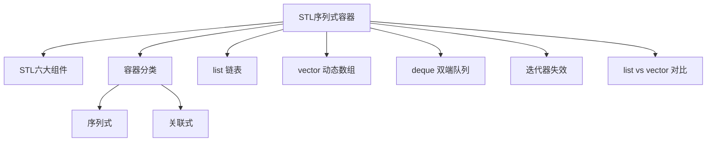
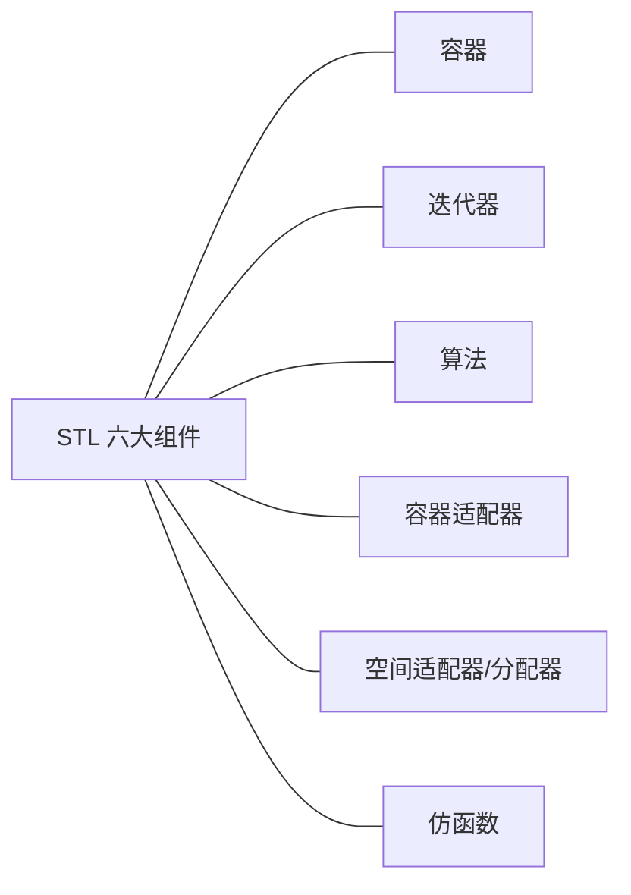

# 05 · STL 序列式容器

> [← 返回索引](./README.md) · 来源：`20261116`（7 页）
> 核心问题：**list / vector / deque 各适合什么场景？迭代器为什么会失效？**

---

## 🧭 本文件结构



---

## 1. STL 六大组件



**容器分类**（已审校修正"元素的值"表述）：

| 分类 | 特点 | 代表容器 |
|---|---|---|
| **序列性容器** | 保持元素**原位置**，允许指定插入/删除位置，每个元素的位置取决于**插入时间/顺序** | `list`、`vector`、`deque` |
| **关联性容器** | 元素位置取决于容器特定的**排序规则**，一般和**元素的值**有关 | `map`、`set`、`hash_map`（哈希 map） |

> 关联式容器详见 [06 · STL 关联式容器](./06-STL关联式容器.md)。

---

## 2. list 链表

### 2.1 结构特点
- **双向循环链表**，支持前驱；`end()` 指向有效元素的下一个位置。
- 迭代器**不支持** `+`、`+=`；**支持** `++`（只能逐个移动）。
- 在任何指定位置插入/删除为 **`O(1)`**。

**结构示意（来自原笔记配图）**：
```
begin()                                end()
   │                                     │
   ▼                                     ▼
┌───┐ Next ┌───┐ Next ┌───┐ Next ┌─────────┐
│ 1 │─────▶│ 2 │─────▶│ 3 │─────▶│ Invalid │
└───┘◀─────└───┘◀─────└───┘◀─────└─────────┘
     _Prev      _Prev      _Prev     (end 后一位)
```

### 2.2 构造与基本操作
```cpp
list<类型> lst(长度, 值);        // 指定默认值
list<类型> lst{类型...};          // 初始化列表
push_front(类型);   // 头增
pop_back();         // 尾删
// 中间删除：迭代器移到指定位置 + erase()
// 注意：迭代器不支持 + / +=，只支持 ++
```

### 2.3 常用成员函数速查

| 函数 | 作用 |
|---|---|
| `insert(it, 类型)` | 在 `it` 前插入，返回新插入元素的迭代器 |
| `front()` / `back()` | 返回首 / 尾元素的值（等价 `*lst.begin()` / `*--lst.end()`） |
| `remove(值)` | 删除链表中**所有**等于该值的节点 |
| `unique()` | 删除**连续且相同**的元素，只保留一个 |
| `sort()` | 排序，默认**升序** |
| `sort(greater<类型>())` | **降序**排列 |
| `reverse()` | 翻转整个链表 |
| `advance(it, 3)` | `it` 正向偏移 3 个（内部相当于执行 3 次 `++`） |
| `splice(...)` | 剪切粘贴（见下） |
| `merge(right, Comp)` | 合并**有序**链表，并清空 `right` |
| `swap(right)` | 交换两个链表 |

### 2.4 splice 三种重载
```cpp
splice(it, lst2);                    // 将 lst2 全部插到 it 前，lst2 被清空 size=0
splice(it, lst2, it2);               // 将 it2 指向的元素剪到 it 前
splice(it, lst2, itbegin, itend);    // 剪切区间 [begin, end)，左闭右开
```

**代码示例（补充）**：
```cpp
list<int> L{3, 1, 2, 1};
L.sort();            // 1 1 2 3
L.unique();          // 1 2 3（去掉连续重复）
L.remove(2);         // 1 3
auto it = L.begin();
advance(it, 1);      // it 指向 3
L.insert(it, 9);     // 1 9 3
```

### 2.5 配套练习（原文印刷题）
> 创建一个 `std::list` 存储自定义 `Person` 结构体（姓名 `std::string`、年龄 `int` 20~40、工资 `int` 10000~90000），添加 10 个对象，信息随机生成。
> - 工资低于 5000 的人按工资**升序**排序放链表前面；
> - 工资大于等于 5000 的人按年龄**降序**排序放后面；
> - 年龄大于 30 且工资低于 4000 的人**移除**；
> - 最后输出剩余人员信息。

> ⚠️ **原题数值矛盾**：工资范围写 10000~90000，但阈值却是 5000 / 4000（疑原题笔误，可能应为 50000 / 40000）。原文照录，未擅自修改，做题时请与出题人确认。

---

## 3. vector 动态数组

### 3.1 内部结构（三指针模型）
```cpp
*m_ptr        // 指向数据
m_len         // 长度（使用量 size）
m_capacity    // 容量
```

**内存示意**：
```
m_ptr ──▶ ┌───┬───┬───┬───┬···┬───┐
          │ 1 │ 2 │ 3 │   │   │   │
          └───┴───┴───┴───┴···┴───┘
          ◀─── m_len ───▶◀─ m_capacity ─▶
          (已用)            (总容量)
```

### 3.2 扩容机制
- **尾删**（效率高）：`m_len--`（等价 `pop_back`）。
- **尾添加**（需扩容）：按 **1.5 倍**扩容（与原笔记"+1"方案比较），过程 = **申请新空间 + 拷贝元素 + 释放旧空间**。
- **vector 不会自动缩容**。

### 3.3 遍历
- `len <= 0`：输出空；
- `len > 0`：遍历输出。

### 3.4 迭代器
- vector 的迭代器是**随机访问型**，支持 `+`、`+=`（与 list 不同）。

| 函数 | 作用 |
|---|---|
| `insert(it, x)` | 插入元素，返回新插入元素的迭代器 |
| `erase(it)` | 删除元素；返回被删元素的**下一个**迭代器（若不是 end 则有效） |

### 3.5 迭代器失效场景（重点）

> ⚠️ 原文确认：**① 元素位置的移动（没有扩容时）；② 扩容都会失效。**

- `erase(it)` 后：传入的迭代器**失效**（指向的虽是下一个元素，但被设为失效状态）；用**返回值**接收新的有效迭代器。
- **扩容后**：所有迭代器全部失效。

**代码示例（补充，正确写法）**：
```cpp
vector<int> v{1,2,3,4};
for (auto it = v.begin(); it != v.end(); ) {
    if (*it % 2 == 0)
        it = v.erase(it);   // 用返回值更新，避免失效
    else
        ++it;
}
```

### 3.6 容量管理

| 函数 | 作用 |
|---|---|
| `clear()` | 清空元素，**使用量减少，容量不变** |
| `empty()` | 是否为空，返回 `bool` |
| `resize(n, val)` | 重新指定使用量；若增加且未超容量则不扩容，超过则扩容 |
| `shrink_to_fit()` | 缩容到合适大小（缩减到使用量） |
| `vector<int>{}.swap(v)` | 与临时空 vector 交换，**交换容量和使用量**（常用缩容技巧） |

---

## 4. deque 双端队列

- **动态以分段连续空间组合**而成（既有数组的随机访问，又能两端高效增删）。

---

## 5. list vs vector 对比（原文印刷要点）

| 对比项 | vector | list |
|---|---|---|
| 存储结构 | **连续空间，顺序存储** | **链式结构体，链式存储** |
| 非尾部插入/删除 | 导致其他元素**拷贝移动** | **不影响**其他节点元素 |
| 内存分配 | 空间不足时**重新分配**内存 | 每次插入新节点都**申请内存** |
| 随机访问 | **性能好** | 性能差 |
| 插入删除 | 性能差 | **性能好** |
| 容量概念 | 有**容量和使用量**概念 | 只有**使用量**（即长度）概念 |

**选择建议**：
- 需要频繁随机访问 ⇒ `vector`
- 需要频繁在中间插入/删除 ⇒ `list`
- 需要两端高效增删 + 随机访问 ⇒ `deque`

---

## 📌 本文件速查

- `list`：双向循环链表，`O(1)` 任意位置插删，迭代器只能 `++`。
- `vector`：动态数组，1.5 倍扩容，随机访问快，**扩容/erase 后迭代器失效**。
- erase 后**务必用返回值更新迭代器**。
- 缩容两招：`shrink_to_fit()` 或 `swap` 技巧。

*返回 [索引](./README.md) · 上一篇 [04 · 预处理与工程化](./04-预处理与工程化.md) · 下一篇 [06 · STL 关联式容器](./06-STL关联式容器.md)*
