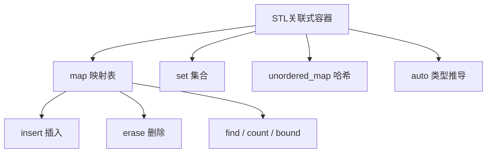

# 06 · STL 关联式容器

> [← 返回索引](./README.md) · 来源：`20261117(1)`（3 页）
> 核心问题：**如何用键值快速查找、去重、做映射？map / set / unordered_map 怎么选？**

---

## 🧭 本文件结构



---

## 1. map 映射表

### 1.1 基本概念
- `map` 是**映射表**，元素分为**键值（key）**和**实值（value）**。
- 特点：
  - **键值唯一，不允许重复**；
  - **根据键值自动排序**。
- 底层：**红黑树**（自平衡二叉搜索树），查找效率 `O(log₂n)`。

**初始化**：
```cpp
map<类型, 类型> m{ {},{},{},... };
```

**元素访问**：
- `first` → 键值（key）
- `second` → 实值（value）
- ⚠️ **map 没有 push / pop 方法**（用 `insert` / `erase`）。

### 1.2 insert 插入（重点）

```cpp
insert( pair<key类型, value类型>(key, value) );
```
- 当**键值已存在** → **插入失败**，返回**已存在元素**的迭代器；
- 当**插入成功** → 返回**新插入元素**的迭代器。

> 💡 因此可用返回值判断插入是否成功：`auto [it, ok] = m.insert(...);`（C++17 结构化绑定）。

**代码示例（补充）**：
```cpp
map<string, int> score;
auto ret = score.insert({"Tom", 90});
if (ret.second) cout << "插入成功";    // bool 表示是否成功

score.insert({"Tom", 100});            // key 已存在，插入失败，仍是 90
```

### 1.3 erase 删除（两种方式）

1. **按位置删除**：
   - `++` 移动（**不支持反向迭代器**）；
   - 传入的迭代器会**失效**；
   - **返回被删元素的下一个**迭代器。
2. **按键值删除**：
   ```cpp
   it = m.find('1');   // 按 key 找到元素
   m.erase(it);        // 或 m.erase('1') 直接按 key 删
   ```
   - 查找效率 `O(log₂n)`（红黑树）。

### 1.4 修改规则（重要）
- **不允许修改键值**（key 是排序依据）；
- **可以修改实值**（value）。

```cpp
it->second = 95;      // ✓ 改实值
// it->first = "X";   // ✗ 改键值，编译错误
```

### 1.5 统计与范围查询

| 函数 | 作用 |
|---|---|
| `count(key)` | 按 key 统计元素的数量（map 中只可能是 0 或 1） |
| `upper_bound(key)` | 返回**大于**给定 key 的**最近**元素位置 |
| `lower_bound(key)` | 返回**大于等于**给定 key 的元素位置（可以等于） |

**红黑树示意（来自原笔记配图）**：
```
          Root
         /    \
      node      node
      /  \      /   \
   leaf  leaf leaf  leaf
   （红黑节点交替，自平衡，保证 O(log n)）
```

---

## 2. set 集合

- **红黑树结构**，**不区分键值和实值**（元素本身就是键）。
- 元素值**唯一，不允许重复**，按照**元素值自动排序**。
- 操作：

| 函数 | 作用 |
|---|---|
| `insert()` | 插入 |
| `find()` | 查找 |
| `erase()` | 删除 |

**代码示例（补充）**：
```cpp
set<int> s{3, 1, 2, 1};
// s = {1, 2, 3}（自动去重 + 排序）
s.insert(5);
if (s.find(3) != s.end()) cout << "存在";
s.erase(2);
```

---

## 3. unordered_map 哈希映射

- **基于哈希表**，数据存储和查找效率非常高，**几乎可当常量级 O(1)**。
- 代价：**消耗更多内存**。

### 3.1 解决哈希冲突（两种经典方法）
1. **拉链法**（链地址法）：冲突元素挂在同一桶的链表上；
2. **线性探测法**（开放定址）：冲突时向后寻找空位。

**拉链法示意（补充）**：
```
桶0 → [key1] → [key2]   （冲突，链表串联）
桶1 → [key3]
桶2 → 空
```

---

## 4. auto 类型推导

- `auto`：**基于初始值，自动转换成相应类型**。
- 常用于接收 `insert` / `find` 返回的复杂迭代器类型，简化代码。

```cpp
auto it = m.find("Tom");     // 自动推导为 map<string,int>::iterator
```

---

## 5. 三种容器怎么选（对比总结）

| 容器 | 底层 | 是否有序 | 查找效率 | 特点 |
|---|---|---|---|---|
| `map` | 红黑树 | **有序**（按 key） | `O(log n)` | key-value 映射，自动排序 |
| `set` | 红黑树 | **有序**（按值） | `O(log n)` | 去重集合 |
| `unordered_map` | 哈希表 | 无序 | **≈O(1)** | 查找最快，耗内存多 |

**选择建议**：
- 要 key→value 映射且需要有序 ⇒ `map`
- 只要去重 / 判断存在 ⇒ `set`
- 追求查找速度、不关心顺序 ⇒ `unordered_map`

---

## 📌 本文件速查

- `map`：`first` 是 key、`second` 是 value；**key 不可改，value 可改**。
- `insert` 返回值能判断是否插入成功（key 重复会失败）。
- `erase` 按位置删返回下一个迭代器；`find` 查找 `O(log n)`。
- `set` 自动去重排序；`unordered_map` 哈希、近似 O(1) 但耗内存。

*返回 [索引](./README.md) · 上一篇 [05 · STL 序列式容器](./05-STL序列式容器.md)*
