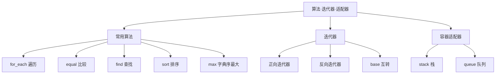
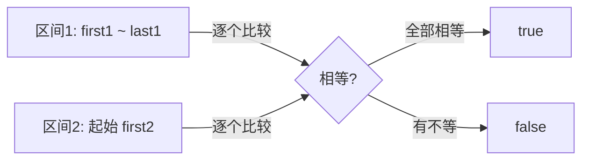
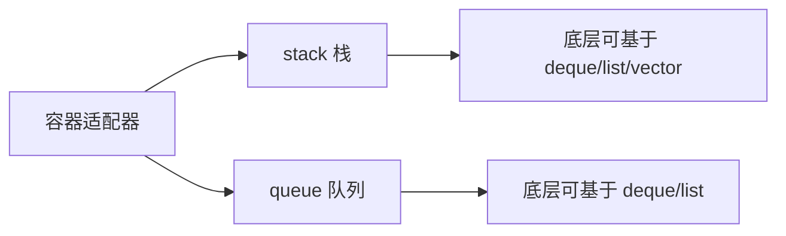

# 07 · STL 算法、迭代器与适配器

> [← 返回索引](./README.md) · 来源：`20261120`（6 页，p1~p4 部分）
> 核心问题：**容器装数据，算法怎么处理数据？迭代器怎么在容器上"走"？**
> 本篇承接 [05 · 序列式容器](./05-STL序列式容器.md) 与 [06 · 关联式容器](./06-STL关联式容器.md)，补全 STL 的"算法 / 迭代器 / 适配器"三大组件。

---

## 🧭 本文件结构



---

## 1. 常用算法

> 算法本质上是**用迭代器操作容器元素的函数**。下表为本页笔记涉及的算法。

| 算法 | 作用 | 关键参数 / 特点 |
|---|---|---|
| `for_each` | 遍历 | `for_each(v.begin(), v.end(), 函数名)`，**左闭右开**区间 |
| `equal` | 比较 | 比较两个区间元素是否相等 |
| `find` | 查找 | `find(v.begin(), v.end(), target)`，查找**目标值** |
| `sort` | 排序 | 默认升序，可传比较器；**要求随机访问迭代器** |
| `max` | 取较大 | 对容器按**字典序**比较 |

### 1.1 for_each 遍历

```cpp
// 左闭右开 [begin, end)
::for_each(v.begin(), v.end(), 函数名);
```

**代码示例（补充）**：
```cpp
void print(int x) { cout << x << " "; }
vector<int> v{1,2,3};
for_each(v.begin(), v.end(), print);   // 输出 1 2 3
```

### 1.2 equal 比较（重点）

```cpp
::equal(v.begin(), vec.end() - 1, vec3.begin());
```
> ⚠️ 原文首参数写 `v.begin()`、第二参数写 `vec.end()-1`，容器名 `v`/`vec`/`vec3` 混用，应为同一容器的笔误；语义上应为比较两个区间。

- **含义**：比较 `first1 ~ last1` 范围内每个元素的值，与**起始于 first2** 的对应元素逐个比较；
- **相等返回 `true`，否则返回 `false`**；
- **约束**（原文强调）：`first2` 所在区间**不能小于** `first1 ~ last1` 范围——如果比较范围小了，**程序会异常（越界）**。



**代码示例（补充）**：
```cpp
vector<int> a{1,2,3}, b{1,2,3,9};
// 比较 a 的全部 3 个元素 与 b 起始的 3 个元素
bool ok = equal(a.begin(), a.end(), b.begin());  // true
// 若 b 元素个数 < a，则越界 → 未定义行为，需自行保证长度
```

### 1.3 find 查找

```cpp
::find(v.begin(), v.end(), target);   // 查找目标值
```
- 在 `[begin, end)` 范围内查找 `target`，返回指向该元素的迭代器；找不到返回 `end()`。

### 1.4 sort 排序（重点）

```cpp
::sort();                                          // 默认升序
::sort(v.begin(), v.end(), greater<int>());        // 降序
::sort(v.begin(), v.begin() + 3, less<int>());     // less → 升序（排前 3 个）
```

- `greater<int>()` → **降序**；`less<int>()` → **升序**（默认即 less）。
- **约束（原文强调）**：
  - **链表（list）迭代器不支持随机访问**；
  - **而 sort 要求随机访问迭代器**；
  - 因此 `list` 不能直接用全局 `std::sort`，要用 **list 自己的成员函数 `lst.sort()`**（回顾 [05 篇 2.3](./05-STL序列式容器.md)）。

| 容器 | 迭代器类型 | 能否用 std::sort |
|---|---|---|
| vector / array | 随机访问 | ✅ 可以 |
| list | 双向迭代器 | ❌ 不可以，用 `list::sort()` |

### 1.5 max 对容器的字典序比较

```cpp
max(list1, list2);
```
- **依次比较每份（每个）元素**；
- 当链表元素**不相等时，返回（值）较大的那个链表**；
- 对 **map 比较，优先看键值（key）**。

> 💡 这是 `std::max` 对容器的**字典序**语义：从左到右逐元素比，第一个不等处决定大小。

**代码示例（补充）**：
```cpp
list<int> l1{1,2,3}, l2{1,2,4};
auto& bigger = max(l1, l2);   // l2 更大（第 3 个元素 4 > 3）

map<int,string> m1{{1,"a"}}, m2{{2,"b"}};
auto& m = max(m1, m2);        // 先比 key：m2 的 key 2 更大
```

---

## 2. 迭代器

### 2.1 正向迭代器

```cpp
list<int>::iterator it = lst.begin();
```

### 2.2 反向迭代器

```cpp
list<int>::reverse_iterator itRev = lst.rbegin();   // ⚠️见下方修正
// 反向的"尾"：lst.rend()
```

> ⚠️ **原笔记笔误修正**：原文写 `itRev = lst.begin()`，但**反向迭代器应由 `rbegin()` 初始化**（原文下一行也写了"反向的尾 `lst.rend()`"，可印证应为 rbegin/rend 配对）。此处按标准 C++ 修正为 `rbegin()`。

### 2.3 反向迭代器转正向：`base()`

```cpp
itRev.base();    // 把反向迭代器转为正向迭代器
```
- **重要特性（原文强调）**：转换后**返回的值会向后偏移一位**。

**原理示意（来自原文配图）**：
```
反向迭代器 rIt 指向元素 4（视觉位置）
   │  .base()
   ▼
正向迭代器指向元素 4 的"下一位"（end 方向偏移一位）

正向:  NULL ← 1 ← 2 ← 3 ← 4 → end(NULL)
            begin →          → end
反向:  rend(NULL) → 4 → 3 → 2 → 1 → rbegin(NULL)
                      ↑ rIt 指向 4
                      .base() → 指向 end（即 4 之后一位）
```
> 记忆口诀：**反向迭代器内部存的是"当前元素的下一位"，所以 `.base()` 会向后偏一位**。

---

## 3. 容器适配器



### 3.1 stack 栈适配器
- 特性：**FILO（First In Last Out，先进后出）**。
- 常用操作：`size`、`empty`、`pop`、`push`、`top`（取栈顶）。

**代码示例（补充）**：
```cpp
stack<int> st;
st.push(1); st.push(2);
st.top();   // 2（栈顶）
st.pop();   // 弹出 2
st.empty(); // false
```

### 3.2 queue 队列适配器
- 常用操作：`empty`、`size`、`back`（队尾）、`front`（队首）、`pop`、`push`。
- 特性：FIFO（先进先出）。

**代码示例（补充）**：
```cpp
queue<int> q;
q.push(1); q.push(2);
q.front(); // 1（队首）
q.back();  // 2（队尾）
q.pop();   // 弹出队首 1
```

| 操作 | stack | queue |
|---|---|---|
| 取元素 | `top()` 栈顶 | `front()` 队首 / `back()` 队尾 |
| 入 | `push()` | `push()`（队尾入） |
| 出 | `pop()` | `pop()`（队首出） |
| 判空/大小 | `empty()` / `size()` | `empty()` / `size()` |

---

## 📌 本文件速查

- 遍历 `for_each` 左闭右开；比较 `equal` 保证第二区间**不短于**第一区间。
- `sort` 要**随机访问迭代器** → list 用自己的 `sort()`。
- 反向迭代器：`rbegin()/rend()` 初始化；`.base()` 转正向**后移一位**。
- stack：**FILO**，`top()`；queue：FIFO，`front()/back()`。

*返回 [索引](./README.md) · 上一篇 [06 · STL 关联式容器](./06-STL关联式容器.md) · 下一篇 [08 · Windows 线程基础](./08-Windows线程基础.md)*
