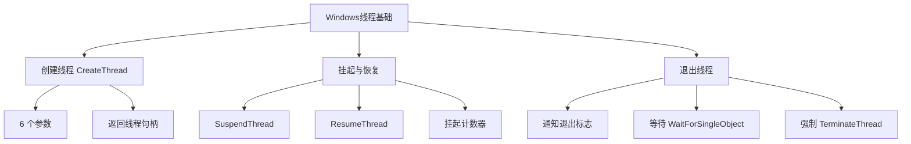
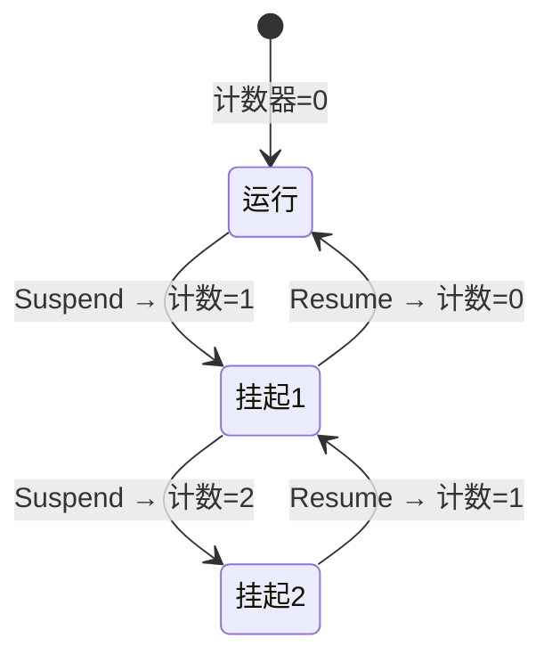

# 08 · Windows 线程基础（Win32 API）

> [← 返回索引](./README.md) · 来源：`20261120`（6 页，p4~p6）
> 核心问题：**如何用 Windows API 创建、挂起、恢复、结束一个线程？**
> 说明：本篇为 Windows 平台 API（`<windows.h>`），非标准 C++ 内容，按原笔记如实整理。

---

## 🧭 本文件结构



---

## 1. 创建线程 `CreateThread`

- 需包含头文件：`<windows.h>`，用 **Windows API** 创建线程。

```cpp
::CreateThread(
    nullptr,      /* 安全属性：nullptr 使用默认值 */
    0,            /* 线程栈大小：0 表示默认大小 */
    &ThreadProc,  /* 线程函数的地址 */
    &n,           /* 传给线程函数的参数 */
    0,            /* 创建标识：0 表示创建后立即执行 */
    nullptr       /* 用于接收线程 id */
);
```

### 1.1 六个参数速查

| 位置 | 参数 | 含义 |
|---|---|---|
| 1 | `nullptr` | 安全属性，nullptr → 默认 |
| 2 | `0` | 线程栈大小，0 → 默认大小 |
| 3 | `&ThreadProc` | 线程函数地址（入口） |
| 4 | `&n` | 传给线程函数的参数 |
| 5 | `0` | 创建标识，0 → 创建后立即执行 |
| 6 | `nullptr` | 接收线程 id（不需要可传 null） |

- **返回值**：**线程的句柄（HANDLE）**。

> 💡 若第 5 个创建标识传入 `CREATE_SUSPENDED`，则线程创建后**不立即执行**（处于挂起态），需后续手动恢复——这与下节"挂起计数器"呼应。

**代码示例（补充）**：
```cpp
#include <windows.h>
DWORD WINAPI ThreadProc(LPVOID lpParam) {
    int* p = static_cast<int*>(lpParam);
    // 线程体...
    return 0;
}
int n = 42;
HANDLE h = ::CreateThread(nullptr, 0, &ThreadProc, &n, 0, nullptr);
```

---

## 2. 线程的挂起与恢复

### 2.1 两个 API

| 操作 | 函数 | 返回类型 |
|---|---|---|
| **挂起** | `::SuspendThread(handle);` | `DWORD` |
| **恢复** | `::ResumeThread(handle);` | `DWORD` |

### 2.2 挂起计数器（核心机制）

- 线程内部维护一个**挂起计数器**：
  - 创建线程时，计数器值为 **0** → 代表线程**运行**。
- **线程可以挂起多次**：挂起几次，就要**恢复 n 次**，线程才能恢复运行。
- **返回值的含义**（原文强调）：
  - **挂起（SuspendThread）返回值 = 挂起之前的计数值（+1 前的值）**；
  - **恢复（ResumeThread）返回值 = 恢复操作之前的值（-1 前的值）**。



**代码示例（补充）**：
```cpp
DWORD prev1 = ::SuspendThread(h);  // 返回挂起前的值（如 0），此后计数=1
DWORD prev2 = ::SuspendThread(h);  // 返回 1，此后计数=2
::ResumeThread(h);                 // 返回 2，计数=1（仍未运行）
::ResumeThread(h);                 // 返回 1，计数=0（恢复运行）
```

---

## 3. 线程的退出

### 3.1 正常退出（推荐）：通知标志
```cpp
isThreadQuit = true;   // 通知子线程退出
```
- 通过一个共享标志变量**通知**子线程主动结束（线程函数内循环检查该标志）。

### 3.2 如何知道子线程是否退出：`WaitForSingleObject`

```cpp
waitForSingleObject(handle, 5000 /* 毫秒 */);
```
- **返回值**：`DWORD` 类型（`flag`）；
- **判断正常退出**：
  ```cpp
  flag == WAIT_OBJECT_0    // 正常退出判断
  ```
- 第二参数是等待超时时间（毫秒），这里为 5000ms。

### 3.3 强制退出：`TerminateThread`

```cpp
::TerminateThread(handle, -1);   // 强制手段，让线程退出
```
- 属于**强制手段**——不推荐常规使用（不会正常清理资源，可能留下不一致状态）。

### 3.4 三种退出方式对比

| 方式 | 函数 / 手段 | 特点 |
|---|---|---|
| **通知退出**（推荐） | `isThreadQuit = true` | 线程自行清理后退出，优雅 |
| **等待确认** | `WaitForSingleObject` + `WAIT_OBJECT_0` | 主线程确认子线程已退出 |
| **强制终止** | `TerminateThread` | 粗暴，可能资源未释放，谨慎使用 |

---

## 📌 本文件速查

- 创建：`CreateThread(安全属性, 栈大小, 函数地址, 参数, 标识, id)` → 返回**句柄**。
- 挂起/恢复：`SuspendThread` / `ResumeThread`，返回**操作前的计数值**；**挂起 n 次要恢复 n 次**。
- 正常退出：置 `isThreadQuit = true`；用 `WaitForSingleObject` 等 `WAIT_OBJECT_0` 确认。
- 强制退出：`TerminateThread`（慎用）。

*返回 [索引](./README.md) · 上一篇 [07 · STL算法与迭代器](./07-STL算法与迭代器.md)*
