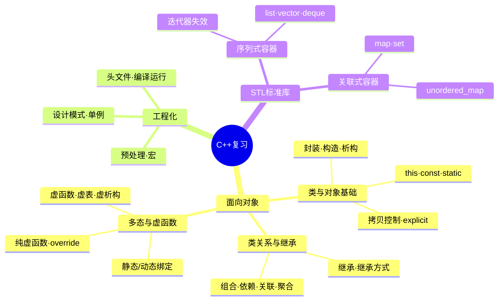
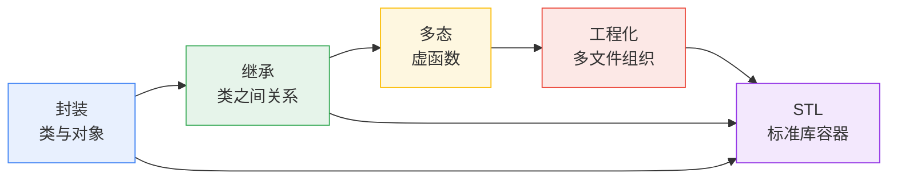

# C++ 复习笔记 · 思维导图索引（MOC）

> 本库由 `手写PDF/` 下 7 份手写笔记（`20261109` ~ `20261117`）识别、审校、重构而成。
> 主题时间跨度约两周，主线是**面向对象四大特性 → 工程化 → STL 标准库**。
> 每个文件可独立阅读、独立调用；不确定之处已全部修正或明确标注，详见[审校说明](./附录-审校说明.md)。

---

## 📚 主题导航（按调用场景进入）

| 文件 | 覆盖主题 | 什么时候看 |
|---|---|---|
| [01 · 类与对象基础](./01-类与对象基础.md) | 封装、构造/析构、this、const、static、拷贝控制、explicit | 写类、防拷贝出错、搞不清 const/static 时 |
| [02 · 类关系与继承](./02-类关系与继承.md) | 组合/依赖/关联/聚合、继承、继承方式、隐藏、成员指针 | 设计类之间关系、排查同名成员时 |
| [03 · 多态与虚函数](./03-多态与虚函数.md) | 静态/动态绑定、虚函数、虚表、虚析构、纯虚函数、override | 理解多态原理、排查内存泄漏时 |
| [04 · 预处理与工程化](./04-预处理与工程化.md) | 宏 define/#/##、头文件防护、编译运行、单例模式 | 写头文件、防重复包含、看编译错误时 |
| [05 · STL 序列式容器](./05-STL序列式容器.md) | STL 六大组件、list、vector、deque、迭代器失效 | 用链表/动态数组、排查迭代器失效时 |
| [06 · STL 关联式容器](./06-STL关联式容器.md) | map、set、unordered_map、红黑树、auto | 需要键值映射、去重、快速查找时 |
| [附录 · 审校说明](./附录-审校说明.md) | 存疑复核结论、修正依据、页码对照 | 想核对原文、追踪修改时 |

---

## 🗺️ 全局知识地图

---

## 🔗 知识脉络（逻辑关系）

**脉络解读**：
1. **封装**是地基——把数据和算法装进类，用访问限定符保护；
2. **继承**在封装之上解决"代码复用与类间关系"；
3. **多态**借继承实现"同一接口、不同行为"，是虚函数的核心；
4. **工程化**把单文件代码拆成头文件/源文件，支撑更大规模的程序；
5. **STL** 是前四者思想的集大成——容器即封装好的类模板，迭代器屏蔽了底层差异。

---

## ✅ 审校状态

- 原 8 处存疑已逐页回查原始手写图：**5 处为识别误读已修正，2 处为作者自留标注已说明，1 处为原笔记知识性错误已纠正**。
- 所有知识点按主题归类，无明显遗漏；代码块为辅助理解的**补充示例**，非原笔记原文，均已注明。
- 无法从笔记确认的内容一律不编造，统一在 [审校说明](./附录-审校说明.md) 中列出。

---

*返回顶部 · 建议从你当前最需要的主题文件开始，不必按顺序通读。*
