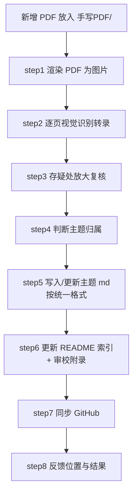
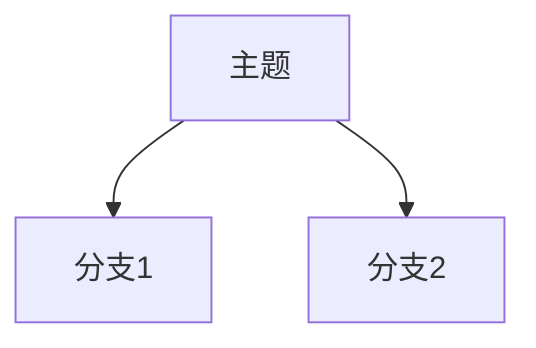

# 新笔记入库 SOP（Standard Operating Procedure）

> [← 返回索引](./README.md)
> **用途**：每当 `手写PDF/` 目录新增手写笔记（如 `20261120.pdf`）时，照本文流程把内容识别、审校、归类、补充可视化，最后同步到 GitHub。
> **原则（第一性）**：一切为了用，不为囤积。**不确定就标注，绝不编造**。
> 本文把 2026-11-20 的实际操作固化为可复用步骤，命令可直接照抄。

---

## 0. 全流程一览



**核心目录**：
- 源笔记：`D:\文档\笔记\C++复习笔记\手写PDF\`
- 整理成果：`D:\文档\笔记\C++复习笔记\思维导图\`
- GitHub：`Micrreney/biji` 仓库的 `C++复习` 分支

---

## 1. 环境与凭据准备（每次先确认）

### 1.1 Python 环境
使用隔离 venv（已装 PyMuPDF + Pillow）：
```
C:/Users/42916/.workbuddy/binaries/python/envs/default/Scripts/python.exe
```
> 若缺库：`.../python.exe -m pip install pymupdf pillow`

### 1.2 Git / GitHub 凭据
- 本会话 bash 中 `git` 需加路径：`export PATH="/c/Program Files/Git/mingw64/bin:$PATH"`
- Token 从凭据管理器读取（**不要明文写进脚本**）：
  ```bash
  export GH_TOKEN=$(printf "protocol=https\nhost=github.com\n\n" | git credential fill 2>/dev/null | grep '^password=' | cut -d= -f2-)
  ```
- ⚠️ **已知坑**：系统 `curl` 与系统 Python 访问 GitHub 报 SSL 证书错误。解决：用隔离 venv Python + `ssl._create_unverified_context()`；中文分支名需 `urllib.parse.quote()` 编码。

---

## 2. Step 1：渲染 PDF 为图片

PDF 通常几 MB，无法直接读取，需先渲染成图片（原图 5226×3316，再压缩到 2000px 便于识别）：

```bash
"C:/Users/42916/.workbuddy/binaries/python/envs/default/Scripts/python.exe" -c "
import pymupdf, os
from PIL import Image
src=r'D:\文档\笔记\C++复习笔记\手写PDF\20261120.pdf'   # ← 改这里：新文件名
out=r'D:\文档\笔记\C++复习笔记\.workbuddy\tmp\pages'
small=r'D:\文档\笔记\C++复习笔记\.workbuddy\tmp\small'
doc=pymupdf.open(src)
print('页数:', len(doc))
for i,page in enumerate(doc):
    pix=page.get_pixmap(matrix=pymupdf.Matrix(2,2), alpha=False)
    name=f'20261120_p{i+1}'   # ← 改这里：文件名前缀
    p=os.path.join(out,name+'.png'); pix.save(p)
    im=Image.open(p).convert('RGB'); im.thumbnail((2000,2000))
    im.save(os.path.join(small,name+'.jpg'),'JPEG',quality=80,optimize=True)
"
```

---

## 3. Step 2：逐页识别转录

- 用图片读取工具逐页打开 `.workbuddy/tmp/small/` 下的 jpg，**逐字转录**。
- 空白处跳过（纯空白页通常压缩后仅 ~37KB）。
- 识别时同步标记：**看不清的字、前后矛盾、疑似笔误** → 攒进"存疑清单"。

> 💡 经验：字迹潦草时，**原文照录 + 标注存疑**，不要当场猜。

---

## 4. Step 3：存疑处放大复核

对每处存疑，从**原始 PNG** 裁剪对应区域放大（不要只用压缩图）：

```bash
"C:/Users/42916/.workbuddy/binaries/python/envs/default/Scripts/python.exe" -c "
from PIL import Image
import os
im=Image.open(r'D:\文档\笔记\C++复习笔记\.workbuddy\tmp\pages\20261120_p3.png').convert('RGB')
w,h=im.size
crop=im.crop((0,int(h*0.30),int(w*0.85),int(h*0.50)))  # ← 按存疑位置调整
crop.thumbnail((2800,2800))
crop.save(r'D:\文档\笔记\C++复习笔记\.workbuddy\tmp\zoom\detail.jpg','JPEG',quality=93,optimize=True)
"
```

**复核结论分三类处理**（对齐审校附录的分类）：
1. **识别误读** → 按放大后的原文修正；
2. **作者自留标注**（如"？"、"例外"）→ 如实说明，不臆造答案；
3. **原笔记知识性/笔误** → 按标准语义修正，**并注明依据**。

---

## 5. Step 4：判断主题归属（关键决策）

> 教练视角：**每条内容先问"以后会在什么场景被用起来"**，再决定放哪个文件。

**决策规则**：
1. 内容能归入现有主题文件 → **追加到该文件**（在对应小节补充，更新该文件顶部来源行）。
2. 内容是全新主题、或现有文件都放不下 → **新建编号文件**（如 `07-...md`、`08-...md`）。
3. 同一篇笔记含多个主题 → 拆分到多个文件（如 `20261120` 拆到 07 与 08）。

**当前主题文件对照表**：

| 编号 | 文件 | 主题 |
|---|---|---|
| 01 | 类与对象基础 | 封装、构造析构、this、const、static、拷贝控制、explicit |
| 02 | 类关系与继承 | 组合/依赖/关联/聚合、继承、继承方式、隐藏、成员指针 |
| 03 | 多态与虚函数 | 绑定、虚函数、虚表、虚析构、纯虚函数、override |
| 04 | 预处理与工程化 | 宏、头文件防护、编译运行、单例模式 |
| 05 | STL 序列式容器 | STL 六大组件、list、vector、deque、迭代器失效 |
| 06 | STL 关联式容器 | map、set、unordered_map、红黑树、auto |
| 07 | STL 算法与迭代器 | for_each/equal/find/sort/max、正反迭代器、base()、stack/queue |
| 08 | Windows 线程基础 | CreateThread、挂起恢复、线程退出 |

> 新建文件时，编号顺延（下一个是 09），并在本表登记。

---

## 6. Step 5：按统一格式写入主题文件

**每个主题文件必须包含的结构**（照抄模板）：

```markdown
# NN · 主题名

> [← 返回索引](./README.md) · 来源：`YYYYMMDD`（N 页）
> 核心问题：**一句话说明这个文件解决什么问题？**

---

## 🧭 本文件结构


---

## 1. 知识点一
- 要点（原文照录）
- ⚠️ 存疑/修正处标注

**代码示例（补充）**：
```cpp
// 明确标注"补充"，非原笔记原文
```

| 对比项 | A | B |
|---|---|---|

---

## 📌 本文件速查
- 一句话记忆点 1
- 一句话记忆点 2

*返回 [索引](./README.md) · 上一篇 [...] · 下一篇 [...]*
```

**四项标配**（缺一不可）：
1. **Mermaid 结构图**（开头）——一眼看清知识骨架；
2. **表格 / 示意图**——对比信息、内存布局、流程；
3. **代码示例**——标注"补充"，帮助理解但不冒充原文；
4. **速查小结 + 前后篇导航**——便于调用。

---

## 7. Step 6：更新索引与审校附录

**README.md 需要改 4 处**：
1. 顶部说明行的**笔记份数、日期范围、主题主线**；
2. **主题导航表**加一行（新文件 + 什么时候看）；
3. **知识地图 mindmap** 加分支；
4. **知识脉络 flowchart + 解读**加节点（若是全新领域）；
5. 审校状态里补一句新笔记的存疑结论。

**附录-审校说明.md 需要改 2 处**：
1. **来源文件清单**加一行（新 PDF、页数、对应主题文件）；
2. 若有存疑，在"存疑复核结论"新增小节（位置/原文/修正/依据）；
3. 更新"完整性与一致性检查"里的份数、页数。

---

## 8. Step 7：同步到 GitHub

用 Git Data API **一次提交**完成"删旧 + 增新"。脚本模板见工作区 `.workbuddy/tmp/sync_github.py`，核心流程：

```
取分支最新 commit sha → 取 base_tree
→ 为每个本地 md 创建 blob（base64）
→ 创建新 tree（base_tree + 新文件条目 + 删除旧文件用 sha:null）
→ 创建 commit → PATCH 更新分支 ref
→ 读回 tree 验证
```

关键代码点：
```python
# 中文分支名要编码
BE = urllib.parse.quote('C++复习', safe='')
# 删除文件：tree 条目 sha 设为 None（由环境变量 DEL_FILE 控制，逗号分隔多个）
{'path': '旧文件.md', 'mode':'100644', 'type':'blob', 'sha': None}
# 新增文件
{'path': f'思维导图/{fn}', 'mode':'100644', 'type':'blob', 'sha': blob_sha}
```

执行（脚本自动扫描 `思维导图/*.md` 全部上传，无需手改文件列表）：
```bash
export PATH="/c/Program Files/Git/mingw64/bin:$PATH"
export GH_TOKEN=$(printf "protocol=https\nhost=github.com\n\n" | git credential fill 2>/dev/null | grep '^password=' | cut -d= -f2-)
export COMMIT_MSG="新增 20261120 笔记：07 STL算法与迭代器、08 Windows线程基础 + 入库SOP"
# 若有需删除的旧文件，设置 DEL_FILE（逗号分隔，留空则不删）
# export DEL_FILE="旧文件.md"
"C:/Users/42916/.workbuddy/binaries/python/envs/default/Scripts/python.exe" "D:/文档/笔记/C++复习笔记/.workbuddy/tmp/sync_github.py"
```

> ⚠️ **新文件路径前缀** `思维导图/` 与仓库保持一致；前缀在脚本里写死，新增文件自动带上。

---

## 9. Step 8：反馈与收尾

- 反馈：上传仓库/分支/文件 URL、验证了什么、遗留事项。
- 在工作日志 `.workbuddy/memory/YYYY-MM-DD.md` 追加本次处理记录。
- 向用户展示更新后的文件。

---

## 10. 常见坑速查表

| 坑 | 现象 | 解决 |
|---|---|---|
| PDF 太大读不了 | >256KB 直接 Read 失败 | 先渲染成 jpg（2000px, quality 80） |
| GitHub SSL 报错 | curl/系统 Python 报 CERTIFICATE_VERIFY_FAILED | 用隔离 venv + `ssl._create_unverified_context()` |
| 中文路径/分支名 | API 404 或乱码 | `urllib.parse.quote()` 编码 |
| git push 要账号密码 | could not read Username | PATH 加 `/c/Program Files/Git/mingw64/bin` |
| 仓库名用中文变成 `-` | GitHub 不支持中文仓库名 | 用拼音（如 biji），描述里写中文名 |
| 存疑处瞎猜 | 内容失真 | 放大复核；实在不行标注"作者未给结论" |
| 所有内容塞一个 md | 难查难用 | 按主题拆分 + MOC 索引，入口从索引进 |

---

## 11. 教练心法（为什么这么设计）

> 这套流程的本质不是"整理笔记"，而是**让笔记能被用起来**：

1. **拆成多个文件 + MOC 索引** → 入口统一从索引进，不靠翻文件夹找东西；
2. **每篇一个"核心问题"** → 触发未来调用场景， answering "以后什么时候用它"；
3. **Mermaid 图 + 速查小结** → 降低回忆成本，一眼进入状态；
4. **明确标注"补充"** → 区分原文与讲解，保持信息可信；
5. **存疑必留痕** → 知识库可追溯，错误能被发现纠正；
6. **维护成本控制** → 新增笔记只需走 8 步、改动集中，不堆仪式。

---

*本 SOP 随实践迭代；若发现更顺手的做法，请回来更新本文。*
